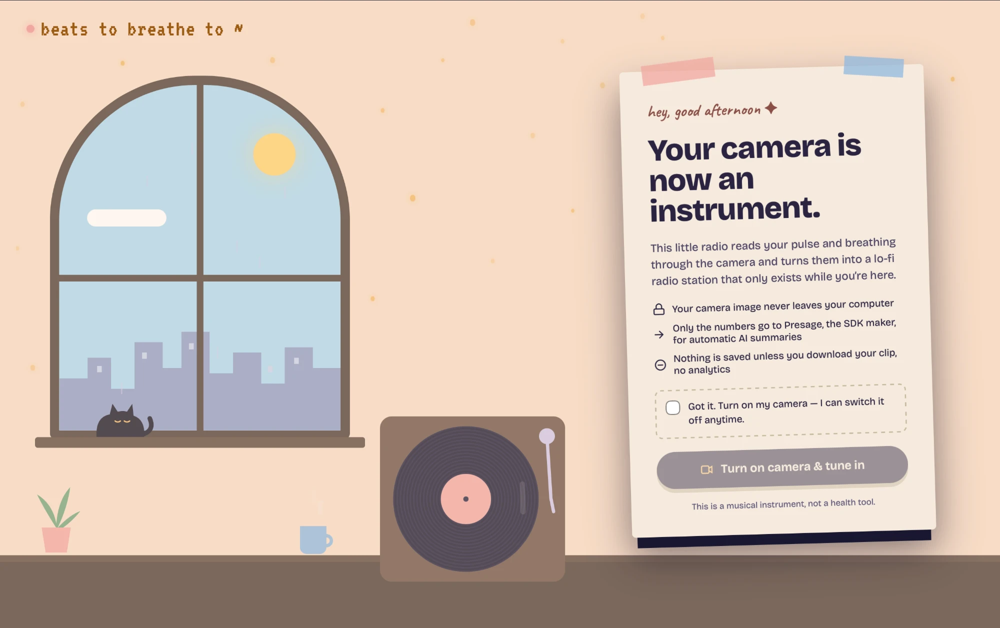
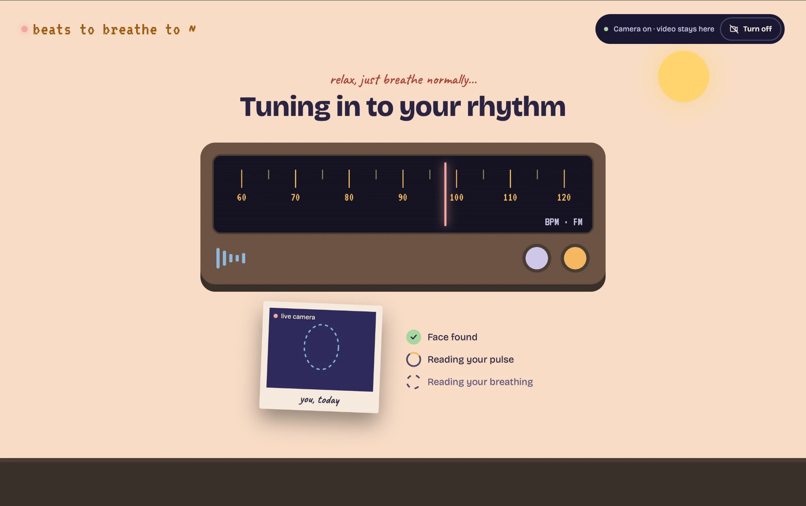
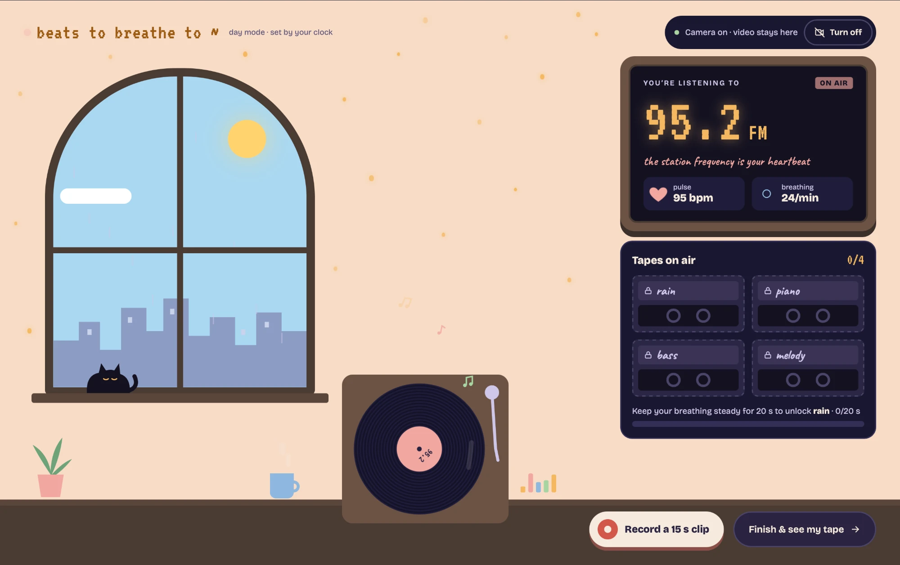
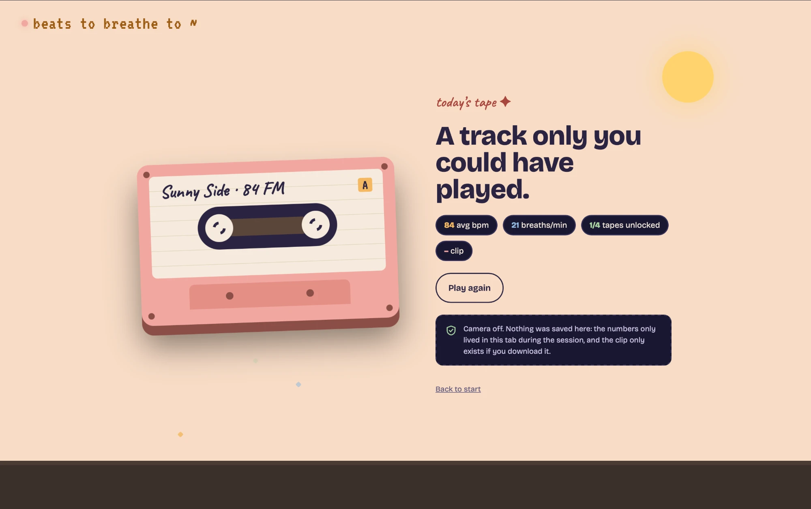
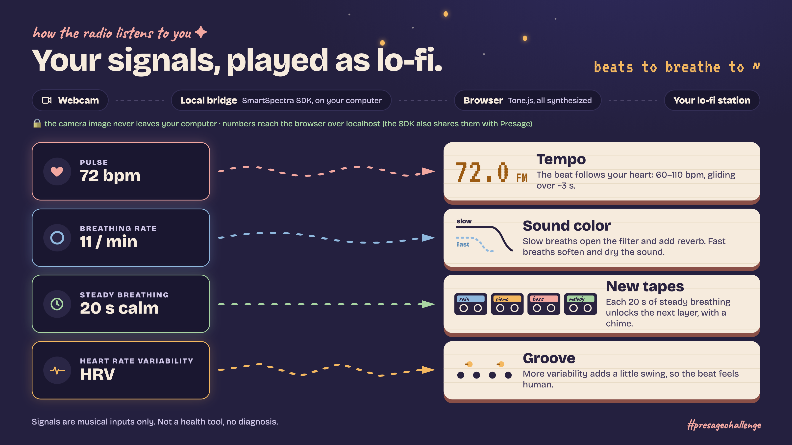

# beats to breathe to

A lo-fi radio that plays at your heart rate. Your webcam reads your pulse and breathing with the [Presage SmartSpectra SDK](https://smartspectra.presagetech.com/), and the music follows: your heartbeat sets the tempo, your breathing shapes the sound, and steady breathing unlocks new cassette tapes (rain → piano → bass → melody). Every session ends as a tape only you could have played, and you can record a 15 s clip of it to watch and download.

> This is a musical instrument, not a health tool.

## Screenshots

| Consent | Tuning in |
|---|---|
|  |  |
| **Now playing** | **Your tape** |
|  |  |

## How it works



| Your signal | What it changes in the music |
|---|---|
| **Pulse** (bpm) | The tempo. Smoothed (EMA), kept between 60 and 110 bpm, ignores changes under 1 bpm and glides to the new tempo over 3 s. Shown as the station frequency, e.g. "72.0 FM". |
| **Breathing rate** (/min) | A low-pass filter and the reverb. Slow breathing (10/min or less) opens the sound up (8 kHz, more reverb). Fast breathing (18/min or more) muffles it (1.2 kHz, drier). Changes over 3 s. |
| **Breathing steadiness** | Unlocks tapes. Staying within ±2/min of your recent median for 20 s unlocks the next layer. Unsteady moments make the counter slip back slowly (half a second per unsteady second) instead of resetting it. |
| **HRV** (RMSSD) | A little swing in the groove (more variability, more swing, up to 0.15). |

The music only starts once your face, pulse and breathing are all being read, and a drum loop with vinyl crackle plays the whole time. If the camera loses your face for 5 s, the music turns down, the tempo holds and the radio dims until you're back. If only the breathing reading drops mid-song (chest out of view, or the SDK re-confirming after you move), the music keeps playing: the breathing tile shows "Reading…" and tape progress pauses until it's back.

## Architecture


<sub>Drawn with Excalidraw: open [`docs/diagram/architecture.excalidraw`](docs/diagram/architecture.excalidraw) at [excalidraw.com](https://excalidraw.com) to edit it.</sub>

There is no browser version of the SDK, so a small local **bridge** runs the [Node SDK](https://www.npmjs.com/package/@smartspectra/node-sdk), owns the camera and sends numbers to the web app. The web app never sends the camera anywhere; it only opens it for the "live camera" polaroid while tuning in and playing. If the SDK asks you to adjust ("Place more of the chest in view."), that tip shows under the polaroid.

- `bridge/index.js`: SDK session, WebSocket server, start/stop.
- `web/src/signals/`: bridge client, simulator, smoothing and steadiness.
- `web/src/audio/`: the Tone.js engine and the signal → sound mapping.
- `web/src/session.ts`: the screen flow (welcome → tuning → playing → tape).
- `web/src/record.ts`: the 15 s clip.

## What you need

- macOS on Apple Silicon (what this was built and tested on). The SDK ships prebuilt runtimes for other platforms too; check its npm page.
- Node.js 22.18 or newer.
- A webcam.
- A free Presage API key: [register here](https://physiology.presagetech.com/auth/register).
- A browser that can record webm with MediaRecorder for clips (built and tested in Chrome). Where that's missing, the Record button is hidden.

## Setup

```bash
git clone git@github.com:GeovanaSLima/beats-to-breathe-to.git
cd beats-to-breathe-to
cp .env.example .env    # then paste your key after PRESAGE_API_KEY=
```

The key lives only in `.env`, which git ignores. The SDK's licensed runtime files come from npm into `node_modules/` and are never committed.

### Run it live (one command)

Install everything once, then start both parts from the project folder:

```bash
npm run setup
```

```bash
npm start
```

This runs the bridge and the web app together in one terminal, with their output labelled `[bridge]` and `[web]`. Open http://localhost:5173, tick the consent box and press **Turn on camera & tune in**. Sit back so your face, shoulders and chest are in view, in good, even light, and stay still. Pulse usually locks in about 10 s; breathing often takes 30–60 s.

Press **Ctrl+C** to stop: it stops both parts and the bridge releases the camera (the browser's own preview turns off when you press Turn off or close the tab). If one part exits, the other is stopped too.

The first time, macOS asks for camera access **for your terminal app** (Terminal, iTerm, VS Code…), because the bridge is a Node process started from it. Allow it in System Settings → Privacy & Security → Camera if you missed the prompt. The bridge's debug page at http://localhost:8787 shows the raw numbers.

<details>
<summary>Or run the two parts in separate terminals</summary>

```bash
cd bridge && npm install && npm start
```

```bash
cd web && npm install && npm run dev
```

</details>

### Run it with the simulator (no camera, no key)

```bash
npm --prefix web install
```

```bash
npm run sim
```

This opens http://localhost:5173/?sim=1 (or set `VITE_SIGNAL_SOURCE=sim`). Fake signals wander around a calm pulse and breathing rate, and an amber **SIMULATED** badge stays on screen. Clips made in this mode carry a SIMULATED label too.

Handy for demos: `?time=day` or `?time=night` overrides the clock-based theme, and `?hidecam=1` keeps your camera image off screen (the tuning polaroid shows a placeholder, the playing one stays hidden) while the bridge still reads your signals live.

### Tests

```bash
cd bridge && npm test
cd web && npm test
```

## Audio and asset licensing

- **All sound is synthesized live with [Tone.js](https://tonejs.github.io/)** (MIT): drums, vinyl crackle, rain, piano, bass, melody and the unlock chime. No samples or recordings are used.
- **Fonts:** Bricolage Grotesque, Caveat and VT323 from [Fontsource](https://fontsource.org/), all under the SIL Open Font License, bundled with the app (no requests to Google Fonts).
- **Illustrations:** hand-made SVG and CSS in this repo.

## Known limitations

- **Light and movement matter.** Low or uneven light, strong backlight, or moving around a lot makes the SDK's readings slower to settle or drop out.
- **Warm-up delay.** The SDK needs time to report stable values: about 10 s for pulse and often 30–60 s for breathing. After that it flags breathing stable only every 10–25 s, so the bridge treats one stable reading as valid for 30 s (or until your chest leaves the frame).
- **Tempo lags a little on purpose.** Smoothing and the 3 s glide keep the music from jumping, so a pulse change shows up in the tempo after a few seconds.
- **Clip duration metadata.** Chrome writes webm files without a duration, so some players show no seek bar until the clip has played once. The clip itself is complete.
- **Clip recording needs the tab visible.** Browsers pause drawing in hidden tabs, so the clip's picture freezes if you switch away while recording.
- **Desktop only.** The SDK runs in the bridge on your computer, next to the browser.

## Privacy and data handling

- **Consent:** the camera turns on only after you tick a checkbox and press a button. You can turn it off at any time from the tuning and playing screens, and it turns off automatically on the final screen.
- **Images stay on your computer:** the camera is read by the Presage SmartSpectra SDK running locally inside the bridge. No camera image or video is recorded, stored or sent anywhere, and the microphone is never used.
- **What is sent to Presage:** the SDK turns the camera feed into numbers (pulse, breathing rate, HRV). Those numbers, never images, go to Presage, the company that makes the SDK, in two cases:
  - **API key check:** the SDK contacts Presage to validate the API key and subscription when a session starts.
  - **Automatic AI summaries:** the SDK also sends the measured numbers to Presage on its own, about every 60 seconds while the camera is on. Presage passes them to an AI model to generate a short summary ("LLM Insights"). This is built into the SDK and can't be turned off. This app never asks for, shows or stores those summaries. Presage's documentation does not say how long it keeps this data. See [Presage's LLM Insights docs](https://smartspectra.presagetech.com/docs/llm-insights).
- **SDK telemetry is off:** the bridge sets `enableTelemetry: false`, so the SDK sends no usage or diagnostic reports. See [Presage's telemetry docs](https://smartspectra.presagetech.com/docs/telemetry-and-privacy).
- **Inside the app:** the numbers travel from the bridge to the browser over `localhost` only. They live in memory during the session and are discarded on stop or close. No accounts, no database, no cookies, no localStorage, no analytics.
- **Your clip:** the 15 s clip is drawn from the music and a canvas view of the radio (vinyl, station frequency, tapes), never the camera image. It is made in memory and saved only if you click Download.
- **Deletion:** closing the tab or pressing "Turn off" stops the camera and drops the session.
- **Not a health tool:** no diagnosis, no medical claims. Pulse and breathing are musical inputs only.
